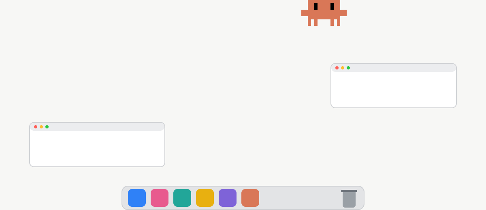
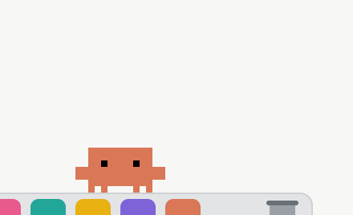
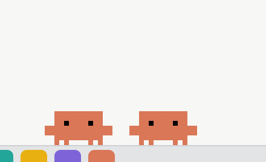

<div align="center">

# 👾 Clawd Desktop Pet

**A tiny pixel-art friend who moves into your Mac.**

Clawd strolls along your Dock, climbs onto your windows and keeps himself busy all day —<br>
coding, shipping releases, flying kites, making coffee … and the occasional nap.

[](../../releases/latest)


[](LICENSE)

<br>



</div>

---

## ✨ Meet Clawd

| | |
|---|---|
| 🏠 **Lives on your desktop** | He walks along the Dock, the bottom of your screens and the tops of your windows, hops between them — and tumbles down when you pull a window away. |
| 🍜 **Has a life of his own** | Calm moments alternate with little activities. He gets hungry and bored, takes naps, and on weekends he works less and plays more. |
| 👋 **Loves company** | Pick him up, throw him, shake him, poke him. Invite up to 10 Clawds — they meet, greet and team up. |
| 📐 **Feels the tilt** | On Apple Silicon MacBooks he slides to the lower side when you tilt your MacBook. |
| 🤫 **Knows when to be quiet** | He goes silent while a video plays and hides when an app goes fullscreen — until the coast is clear. |
| 🎵 **Has his own voice** | Every squeak, *huch* and *wheee* is synthesized on the fly — no audio files. |
| 🎨 **Fits right in** | Light and dark appearance, English and German, and adjustable size, speed, activity, chattiness and volume. |

## ☀️ A day with Clawd

<table>
  <tr>
    <td align="center"><br><b>☕ Morning coffee</b></td>
    <td align="center"><br><b>💻 Coding</b></td>
    <td align="center"><br><b>📊 Team presentation</b></td>
    <td align="center"><br><b>😴 Well-earned nap</b></td>
  </tr>
</table>

## 🎭 What does he get up to?

No spoilers! Here's just how many little scenes there are in each group — discover the rest yourself.

| | Group | Scenes |
|---|---|---:|
| 👋 | Gestures & States | 10 |
| 🪁 | Free Time & Sports | 9 |
| ☕ | Everyday | 9 |
| 🔨 | Crafts | 5 |
| 💻 | Programming | 11 |
| 🚀 | Release & Ops | 8 |
| 🖨️ | Office | 5 |
| 🎧 | Focus & Stress | 4 |
| 🤝 | Encounters *(two Clawds)* | 9 |
| 👥 | Team Scenes *(two Clawds)* | 5 |
| | **Total** | **75** |

## 📦 Installation

1. **Download** `Clawd-Desktop-Pet-<version>.zip` from the [Releases](../../releases) page.
   It's a universal app that contains both versions — for Apple Silicon and for Intel Macs — so
   there's only one download.
2. **Unzip** it and move **Clawd Desktop Pet.app** to your Applications folder.
3. **Open** it. The app isn't notarized by Apple, so macOS refuses to open it the first time and
   says it can't verify the app. To allow it once:
   - open **System Settings → Privacy & Security**, scroll down and click **Open Anyway** next to
     the message about Clawd Desktop Pet, then confirm with your password,
   - or run this in Terminal:
     ```bash
     xattr -dr com.apple.quarantine "/Applications/Clawd Desktop Pet.app"
     ```

   Rather not trust a downloaded build? Build it yourself from source — see below.
4. **Say yes** to the Accessibility permission, so Clawd can find the Dock. 🎉

## 🎛️ The menu

Clawd lives in your menu bar. Click his icon to make him feel at home:

| Setting | What it does |
|---|---|
| ➕ Add / Remove Clawd | Brings another Clawd onto your desktop or sends one away. |
| 🔢 Number of Clawds | How many Clawds are around at once (1–10). |
| 🍜 Feed Clawd | Serves a meal to your hungry Clawds. |
| 📏 Size | Small, Medium or Large. |
| 🏃 Speed | Leisurely, Normal or Brisk. |
| ⚡ Activity | How busy he keeps himself, from Lazybones to Hyperactive. |
| 💬 Chattiness | How much he talks on his own, from Silent to Chatterbox. |
| 🌗 Appearance | Automatic (like macOS), Light or Dark. |
| 🌍 Language | Automatic (like macOS), Deutsch or English. |
| 🔊 Volume | Slider for his voice. A note appears above it while a video keeps him quiet. |
| 🪟 Walk on Windows | Lets Clawd climb onto the tops of your windows. |
| 🧲 Magnetic Shoes | Lets him walk up and down the sides of your windows and the edges of your screen. |
| 📐 React to Tilt | Tilt your MacBook and Clawd slides to the lower side. Only shown on MacBooks with a motion sensor. |
| 🔁 Open at Login | Starts Clawd automatically when you log in. |
| 🔐 Open Accessibility Settings… | Shortcut to the permission he needs to find the Dock. |

## 🪶 Light as a feather

Clawd is meant to keep you company all day without showing up in Activity Monitor:

| | Approx. |
|---|---|
| 🧠 Memory | about 15 MB |
| ⚙️ CPU | about 3 % of one core with one Clawd, measured on an Apple M2 Max |
| 🌐 Network | none — the app never goes online |

The window list is read twice per second and the Dock every two seconds; only while Clawd is standing
on a window or flying through the air does he look more often. All graphics and sounds are generated
at runtime — no image or audio files — and every sprite is rendered once and then cached.

## 🛠️ Build it yourself

You need **macOS 14 (Sonoma)** or later and **Swift 5.9** or later (Xcode or the Command Line Tools).

```bash
./build.sh            # builds "build/Clawd Desktop Pet.app"
./build.sh install    # … and copies it to ~/Applications (recommended for "Open at Login")
./build.sh release    # universal app (Apple Silicon + Intel), zipped in build/ for a GitHub release
./test.sh             # runs the test suite
```

The only permission Clawd asks for is **Accessibility** — used solely to read where the Dock and its
icons are, so he can walk on it.

<details>
<summary><b>🧩 How it's built</b></summary>

<br>

Plain Swift with AppKit and Core Animation, packaged with Swift Package Manager — no third-party
dependencies.

| Part | What it does |
|---|---|
| `Stage` | One transparent, click-through overlay window per screen. Every Clawd and every prop is a `CALayer` on it, driven by a single 60 Hz tick. |
| `World` | Knows every surface Clawd can stand on: the Dock (via the Accessibility API), screen edges and visible window edges (via the window list). |
| `PetController` | One Clawd: a state machine for walking, idling, physics (falling, throwing, landing), mouse handling, needs and the choice of the next activity. |
| `Job` | A solo activity, written as a small script in phases (walk there → get the tool out → work → done) with its own props. |
| `Encounter` | The same idea for two Clawds that meet. |
| `ClawdSprite` | All pixel art, drawn as text grids (`"..XXEXX.."`) and rendered into cached, crisp `CGImage`s, themed for light and dark. |
| `Voice` | Procedural speech: syllables synthesized with `AVAudioEngine`, with per-event chattiness. |
| `TiltSensor` | Reads the MacBook's built-in motion sensor, so Clawd can slide when you tilt it. |
| `MediaWatcher` | Detects video playback (power assertions) and fullscreen apps (window list). |
| `Playground` | An optional window with its own mini Dock and boxes instead of real windows, used for testing. |

Sources live in `Sources/Clawd` (activities in `Sources/Clawd/Jobs`), tests in `Tests/ClawdTests`.

**Developer launch options** — handy for trying things out without the menu:

```bash
"build/Clawd Desktop Pet.app/Contents/MacOS/Clawd" --demo <action>      # e.g. --demo job:deploy
"build/Clawd Desktop Pet.app/Contents/MacOS/Clawd" --drop 900,700 --force <action>
```

Further options (`--pair`, `--encounter <kind>`, `--playground`, `--weekend`, `--weekday` …) are
documented in `Sources/Clawd/LaunchOptions.swift`.

</details>

---

<div align="center">

Made with 🧡 and a lot of tiny pixels · [MIT License](LICENSE)

<sub>Clawd Desktop Pet is an unofficial fan project and is not affiliated with or endorsed by Anthropic.</sub>

</div>
